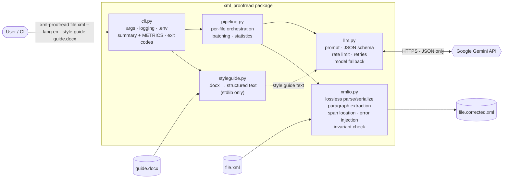
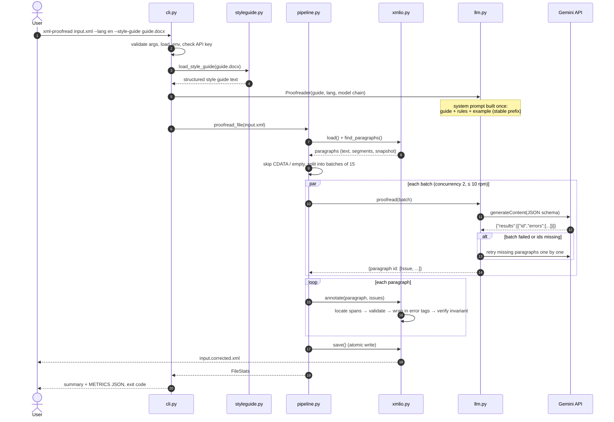
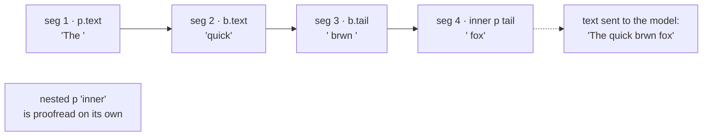
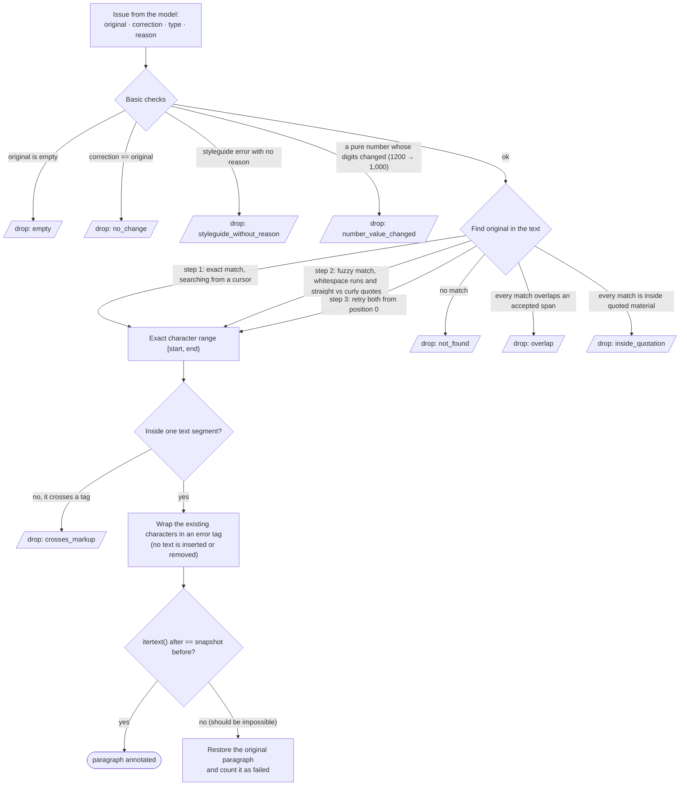
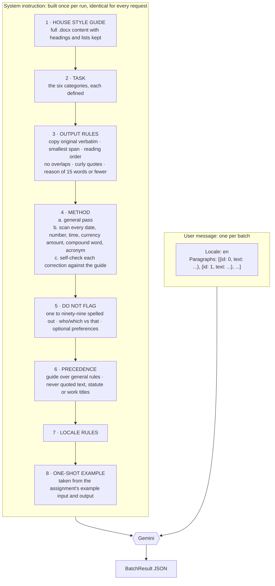
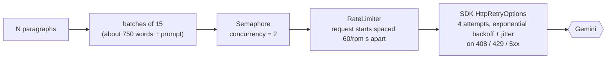
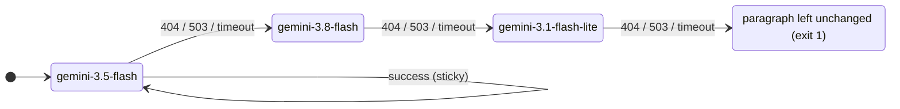
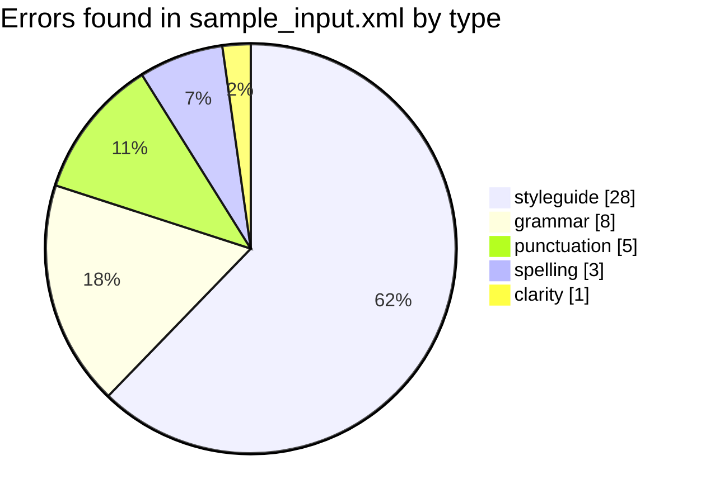

# xml-proofread

**A command-line tool that uses Google Gemini to proofread `<p>` elements in XML files and marks every error
inline. It never changes the document's text, structure or formatting.**

```xml
<!-- input -->
<p>The firm reported approximately $2,000,000 in revenue for January, 2024, and plans to expand it's publicly-owned subsidiaries.</p>

<!-- output: input.corrected.xml -->
<p>The firm reported approximately <error type="styleguide" correction="$2 million" reason="Spell out million, billion, etc.">$2,000,000</error>
in revenue for <error type="styleguide" correction="January 2024" reason="No comma between month and year.">January, 2024</error>,
and plans to expand <error type="punctuation" correction="its" reason="Possessive its has no apostrophe.">it's</error>
<error type="styleguide" correction="publicly owned" reason="Do not hyphenate ly adverbs.">publicly-owned</error> subsidiaries.</p>
```

(The output paragraph is wrapped here only for readability. Real output keeps the original line exactly as it was.)

| | |
|---|---|
| **Error categories** | grammar · spelling · punctuation · capitalization · clarity · styleguide |
| **Every error has** | `type`, `correction` and a short `reason` (extra credit) |
| **Guarantee** | Text content of every `<p>` with the `<error>` tags removed is **identical** to the input: same characters, same whitespace |
| **Untouched** | All other elements, attributes, namespaces, comments, CDATA, the XML declaration, and paragraphs with no errors (byte-for-byte) |
| **Locale** | `--lang` (BCP-47) switches the spelling variety and which rules apply |
| **Metrics** | Time per file, peak memory, token usage and error statistics, as a readable summary and as JSON |

---

## Contents

1. [Quick start](#1-quick-start)
2. [Usage](#2-usage)
3. [High-level architecture](#3-high-level-architecture)
4. [End-to-end flow](#4-end-to-end-flow)
5. [How the length invariant is guaranteed](#5-how-the-length-invariant-is-guaranteed)
6. [LLM design](#6-llm-design)
7. [Style guide integration](#7-style-guide-integration)
8. [Locale-aware proofreading](#8-locale-aware-proofreading)
9. [Reliability and error handling](#9-reliability-and-error-handling)
10. [Performance and metrics](#10-performance-and-metrics)
11. [Results on the provided samples](#11-results-on-the-provided-samples)
12. [Testing](#12-testing)
13. [Project layout](#13-project-layout)
14. [Limitations and future work](#14-limitations-and-future-work)

---

## 1. Quick start

You need Python ≥ 3.10 and [uv](https://docs.astral.sh/uv/). Plain `pip` also works.

```bash
git clone https://github.com/saditha93/xml-proofread-cli.git
cd xml-proofread-cli
uv sync                                   # installs google-genai, lxml, pytest into .venv
cp .env.example .env                      # then set GEMINI_API_KEY=...  (https://aistudio.google.com/apikey)

uv run xml-proofread examples/sample_input.xml --lang en --style-guide examples/style_guide.docx
# -> examples/sample_input.corrected.xml
```

<details>
<summary>Using pip instead of uv</summary>

```bash
python -m venv .venv && . .venv/bin/activate
pip install -e . pytest
xml-proofread examples/sample_input.xml --lang en --style-guide examples/style_guide.docx
```
</details>

The API key is read from the `GEMINI_API_KEY` environment variable or from `.env` in the current
directory. `.env` is gitignored. A free-tier key is enough.

---

## 2. Usage

```
xml-proofread FILE [FILE ...] --lang LANG --style-guide GUIDE.docx
              [--model CHAIN] [--thinking low|medium|high]
              [--batch-size N] [--concurrency N] [--rpm N] [-v]
```

| Option | Default | Purpose |
|---|---|---|
| `FILE [FILE ...]` | – | One or more XML files. Each one is written to `<name>.corrected.xml` in the same directory. |
| `--lang` | *required* | A BCP-47 tag such as `en`, `en-US`, `en-GB`, `fr` or `de-CH`. See [§8](#8-locale-aware-proofreading). |
| `--style-guide` | *required* | The style guide `.docx`. |
| `--model` | `gemini-3.5-flash,gemini-3.8-flash,gemini-3.1-flash-lite` | A model id, or a comma-separated **fallback chain**. See [§6.4](#64-model-fallback-chain). Can also be set with `$GEMINI_MODEL`. |
| `--thinking` | `medium` | Model reasoning effort. `low` is about 25% faster; `medium` is more reliable on style rules. See [§10](#10-performance-and-metrics). |
| `--batch-size` | `15` | Paragraphs per request. |
| `--concurrency` | `2` | Requests in flight at once. |
| `--rpm` | `10` | Client-side cap on requests per minute (`0` = unlimited). Tuned for the free tier. |
| `-v` | off | Debug log: prompts, raw model responses, and every rejected suggestion with the reason. |

**Exit codes**

| Code | Meaning |
|---|---|
| `0` | All files proofread successfully. |
| `1` | Output was written, but some paragraphs could not be proofread. They are left unchanged. |
| `2` | Fatal error: missing key, unreadable or invalid XML, bad style guide, or bad arguments. |
| `130` | Interrupted (Ctrl-C). |

---

## 3. High-level architecture



**Design principle: the model never writes XML.** Gemini returns structured JSON that describes each
error. Deterministic code then decides where each error goes and wraps the existing text. This
separation is what makes the output well-formed and the length invariant hold, however the model behaves.

| Module | Responsibility | Key dependencies |
|---|---|---|
| `cli.py` | Parses and validates arguments (including the BCP-47 check), sets up logging, loads `.env`, runs all files in one event loop, prints the summary and `METRICS` JSON, and sets the exit code | `argparse`, `asyncio` |
| `pipeline.py` | For each file: load → collect paragraphs → batch → proofread concurrently → annotate → save. Also collects `FileStats`. | – |
| `xmlio.py` | Lossless XML input and output, `<p>` discovery, text segments, matching suggestions to exact character ranges, injecting `<error>` tags, the invariant check, and atomic writes | `lxml` |
| `llm.py` | System and user prompts, the Pydantic response schema, the Gemini async client, the rate limiter, the fallback chain and token accounting | `google-genai`, `pydantic` |
| `styleguide.py` | Converts the `.docx` into Markdown-like text and keeps its heading and list hierarchy | `zipfile`, `xml.etree` |

---

## 4. End-to-end flow



### 4.1 XML parsing that loses nothing

`lxml` is configured to keep everything:

```python
XMLParser(strip_cdata=False, remove_blank_text=False, remove_comments=False, remove_pis=False,
          resolve_entities=False, no_network=True, huge_tree=True)
```

- CDATA, comments, processing instructions, whitespace, namespaces and attribute order are all preserved.
- `resolve_entities=False` and `no_network=True` block XXE (XML external entity) attacks from untrusted input.
- lxml would rewrite `<?xml version="1.0" ...?>` with single quotes. To avoid that, the tool writes back
  the original declaration bytes exactly, along with any BOM and the trailing newline.
- As a result, a file with no errors comes out **byte-identical** to the input. The tests check this for
  every example file.

### 4.2 Finding paragraphs

- Paragraphs are collected in document order. Matching uses the element's local name, so `<p>`,
  `<x:p>` and `<p>` under a default namespace are all found.
- A **nested `<p>`** is proofread as its own paragraph.
- **Inline markup** (`<b>`, `<i>`, …) inside a paragraph is read as part of that paragraph's text. The
  text is split into *segments* at every tag boundary.

Example: `<p>The <b>quick</b> brwn <p>inner</p> fox</p>`



An error is wrapped inside the one segment that contains it, so the resulting XML is always well-formed.

---

## 5. How the length invariant is guaranteed

> *Requirement: for each `<p>`, the text content (excluding `<error>` tags and attributes) must have
> exactly the same characters and whitespace as the original.*

Asking an LLM to rewrite XML and hoping it keeps every character is fragile. This tool never lets the
model produce text that goes into the document. The model only names text that is already there:

```json
{"original": "January, 2024", "correction": "January 2024", "type": "styleguide",
 "reason": "No comma between month and year"}
```

Each suggestion then goes through a deterministic pipeline:



Key points:

- **Correct by construction.** An `<error>` element contains a slice of the original text, and the text
  before and after it becomes the surrounding text and tails. Characters are only moved between nodes,
  never created or removed. The check after each paragraph is a guard against bugs; it does not depend
  on the model behaving.
- **Repeated words.** The model lists errors in reading order. A cursor moves forward through the text,
  so the second `it's` maps to the second occurrence.
- **Quoted material.** The style guide says to *never edit quoted material*. Only **paired** double
  quotes (`“…”`, or `"…"` paired in order) mark it. Apostrophes are never treated as quotes, so `it's`,
  `1930's`, `advisor's` and `Workers'` can still be flagged. An unmatched quote marks nothing. If a word
  appears both inside and outside quotes, the occurrence outside is the one flagged.
- **Namespaces.** `<error>` is created in the paragraph's namespace, so a document with a default
  namespace gets a clean `<error>` and never `xmlns=""`.
- **Attributes** are always in the order `type`, `correction`, `reason`. lxml escapes the values.
  `reason` is left out when it's empty, which is what lets `example_output.xml` be reproduced byte-for-byte.
- Every rejected suggestion is counted by cause in the metrics (`dropped`) and logged with `-v`.

---

## 6. LLM design

### 6.1 Structured output

Responses are constrained by a Pydantic schema, passed to Gemini as `response_schema` with
`response_mime_type="application/json"`:

```python
class Issue(BaseModel):
    original: str        # verbatim substring of the paragraph
    correction: str
    type: Literal["grammar", "spelling", "punctuation", "capitalization", "clarity", "styleguide"]
    reason: str          # required for every error (extra credit)

class ParagraphResult(BaseModel):
    id: int
    errors: list[Issue]

class BatchResult(BaseModel):
    results: list[ParagraphResult]
```

### 6.2 Prompt structure



- The style guide comes **first**, and the system instruction is identical for every request. That
  makes it a stable prefix, so Gemini's **implicit context caching** can reuse it (`cached=2199` tokens
  was observed on a free-tier run). The locale goes in the user message so it doesn't break the cache.
- The **METHOD**, **DO NOT FLAG** and **number guard** rules came from prompt-tuning rounds on
  `sample_input.xml`. Each one removed a specific failure: missed `U.C.C.` and `May 12, 2021`, false
  `fifteen → 15`, `who → that`, and a hallucinated `1200 → 1,000`. See [§11](#11-results-on-the-provided-samples).

### 6.3 Batching, concurrency and rate limiting



Paragraphs are at most about 50 words, so batching is where the speed comes from. The provided sample
(14 paragraphs) takes **one request**. Batches run concurrently and are merged by paragraph id.

### 6.4 Model fallback chain

Model availability changes, and the free tier can be overloaded. `--model` therefore takes a chain, and
the tool moves to the next model **and stays on it** for the rest of the run:



A `400 Bad Request` or other client error does **not** fall back, because it would fail on every model.

The default chain comes from live tests with a free-tier key in November 2026:

| Model | Observed |
|---|---|
| `gemini-2.5-flash` | `404: no longer available to new users`, so it is not in the chain |
| `gemini-3.8-flash` | `503 high demand` or a hanging request (over 200 s) |
| `gemini-3.5-flash` | About 4 s for a one-paragraph request. Best quality and speed. **First in the chain.** |
| `gemini-3.1-flash-lite` | Works. Last resort. |

---

## 7. Style guide integration

The `.docx` is read with the standard library only (`zipfile` plus `word/document.xml`). Its structure is
kept because the LLM follows rules better when it can see which section a rule belongs to:

| Word formatting in the provided guide | Becomes |
|---|---|
| Centered bold paragraph (e.g. *List of Preferred Word Usage*, *Capitalization Style*) | `# Heading` |
| `PLI_Level 1 Head` / `Heading1` style | `## Heading` |
| `PLI_Level 2 Head` / `Heading2` style | `### Heading` |
| Numbered or bulleted (`numPr`, `ListParagraph`) | `- item`, indented by list level |
| `PLI_Sample` (example lines) | `  e.g. …` |
| `PLI_Note Text` | indented note |

```text
# In-House Style Guide Rules
## Dates (Months, Days, Years)
In both text and footnotes, there is no comma between the month and the year. So:
  e.g. January 2022 not January, 2022
...
# List of Preferred Word Usage
acknowledgment (not acknowledgement)
...
## Hot Spots for Errors
### Commonly confused words:
```

How reliability is achieved:

1. The **full** guide goes into every request; it is never summarized, so no rule is lost.
2. The guide's structure is kept, as shown above.
3. A systematic **scan checklist** and a **self-check** are in the prompt.
4. A **one-shot example** shows what correct `styleguide` reasons look like.
5. **Deterministic guards** run after the model: quoted material, number values, and a required reason
   for `styleguide` errors.

How efficiency is achieved: the guide is about 2.5k tokens, sent once per batch rather than once per
paragraph, and it sits in a cacheable prefix.

---

## 8. Locale-aware proofreading

`--lang` must be a valid BCP-47 tag (`^[A-Za-z]{2,3}(-[A-Za-z0-9]{2,8})*$`). It changes the model's behavior:

| `--lang` | Spelling | Style guide applied |
|---|---|---|
| `en`, `en-US`, other `en-*` | American (`organisations → organizations`) | All of it |
| `en-GB`, `en-AU`, `en-NZ`, `en-IE` | That variety's spelling | All except the spelling preferences |
| Anything else (`fr`, `de`, `es`, …) | That language's grammar, spelling and typography | Only the language-neutral rules: dates, numbers, currency, time, quotation marks. The English word list does not apply. |

The `reason` is always written in English for reviewers. Example live run with `--lang fr`:

```xml
<p>Le <error type="spelling" correction="comité" reason="Missing accent mark">comite</error> a
<error type="grammar" correction="décidé" reason="Incorrect past participle verb form">decide</error> ...
en <error type="capitalization" correction="janvier" reason="Months of the year are not capitalized in French">Janvier</error> 2024.</p>
```

---

## 9. Reliability and error handling

| Failure | Handling |
|---|---|
| Missing API key, bad style guide, invalid `--lang` | Clear one-line error and exit `2` before any work is done |
| Missing or malformed XML file | Logged with the parser's line and column; other files continue; exit `2` |
| 429 rate limit, 5xx, timeouts | SDK retries with exponential backoff and jitter (4 attempts); client-side RPM limiter |
| Model retired (404) or overloaded (503) | Sticky fallback to the next model in the chain ([§6.4](#64-model-fallback-chain)) |
| Whole batch fails, returns unparsable JSON, or leaves out ids | Missing paragraphs are retried **one at a time** |
| A single paragraph still fails | Left **unchanged**, counted as `failed`, exit `1` |
| The model suggests a span that doesn't exist, overlaps, crosses a tag, or is inside quotes | Dropped, counted by cause, logged with `-v` |
| Hallucinated number (`1200 → 1,000`) | Dropped (`number_value_changed`) |
| Injection would change the text (a bug) | Paragraph restored from a backup, counted as `failed` |
| Crash while writing output | Atomic write (temp file, then `os.replace`), so no partial or corrupt output file is ever left |
| XML external entity (XXE) attacks | Entity resolution and network access are disabled in the parser |

Logs go to **stderr**. Results and metrics go to **stdout**, so `2>log.txt` captures the log only.

---

## 10. Performance and metrics

Each file prints a summary and a single JSON line meant for scripts:

```text
examples/sample_input.xml -> examples/sample_input.corrected.xml
  time            37.30 s   peak RSS 72.2 MB
  paragraphs      14 total | 14 corrected | 0 clean | 0 failed | 0 skipped
  errors          45 (clarity=1, grammar=8, punctuation=5, spelling=3, styleguide=28)
  dropped         -
  api             gemini-3.5-flash | 1 request(s), 0 failed | tokens in=4774 out=2591 cached=0 thinking=3552
METRICS {"input": "examples/sample_input.xml", "seconds": 37.3, "peak_rss_mb": 72.2, "paragraphs": 14, ...}
METRICS_TOTAL {"files": 1, "seconds": 37.31, "peak_rss_mb": 72.2, "exit_code": 0}
```

- **Peak RSS** is read from `resource.getrusage`. It is reported in KB on Linux and bytes on macOS; the
  tool converts both to MB and prints `n/a` on Windows.
- Nearly all wall time is the model call. Parsing, matching and injection take milliseconds, and memory
  stays around 72 MB (mostly the Python runtime and SDK).

**Speed versus accuracy (`--thinking`).** Two runs per setting on `sample_input.xml`, all 14 paragraphs in one batch:

| `--thinking` | Time per batch | Thinking tokens | Corrections that contradict the guide |
|---|---|---|---|
| `low` | 28.8 – 29.1 s | 0 | `toward → towards`, `legal advisors → advisers` |
| `medium` *(default)* | 36.3 – 46.8 s | about 4,000 | none |

Measured on the Gemini free tier (Nov 2026). Latency varies with load.

**How to make it faster:**
- Raise `--concurrency` and `--rpm` on a paid key.
- Use `--thinking low` when a few extra false positives are acceptable.
- Lower `--batch-size` to spread a large file across more parallel requests.

---

## 11. Results on the provided samples

### `example_input.xml` vs `example_output.xml`

The live run finds **exactly the same 10 errors** as the expected output: the same spans, types and
corrections. It also adds a `reason` to every one. Paragraph 4 has no errors and stays byte-identical. The
offline golden test, which replays the expected errors through the full pipeline, reproduces
`example_output.xml` **byte-for-byte**.

### `sample_input.xml` (14 paragraphs, 45 errors)



All the issues planted in the sample were caught, including:

| Style-guide rule | Caught in the sample |
|---|---|
| Dates | `January, 2020`, `June, 2024` → no comma; `May 12 2021` → `May 12, 2021` |
| Numbers and currency | `1200 → 1,200`; `$3,000,000 → $3 million`; `US $4.5 million → US$4.5 million` |
| Time | `6:00 AM → 6:00 a.m.`; `3:30PM → 3:30 p.m.` |
| Plural years | `1930's → 1930s` |
| Hyphenation | `publicly-owned`, `wholly-owned`, `third party vendors`, `common law principles`, `cross border`, `attorney client`, `post petition` |
| Preferred words | `judgement`, `acknowledgement`, `web sites`, `time-frames`, `pre-existing`, `set-off`, `non profit`, `super priority`, `Workers compensation → Workers’ compensation` |
| Acronyms and capitalization | `HIPPA → HIPAA`, `U.C.C → U.C.C.`, `Biden administration → Administration` |
| General errors | `have/has` agreement, `then/than`, `their/there`, `effect/affect`, `a important`, `it's/its`, `Its/It's`, possessives, spelling, American spelling, one clarity rewrite |

Headings such as `implementation Guidelines For Compliance Teams` are **not** `<p>` elements, so they are
correctly left alone, along with every `meta:*` element and attribute.

### How prompt tuning got there

| Round | Change | Effect |
|---|---|---|
| 1 | Baseline prompt | 48 errors. Missed `U.C.C.` and `May 12, 2021`. Wrong: `1200 → 1,000`, `fifteen → 15`, `toward → towards`. 3 preference-only `who/which → that`. |
| 2 | Scan checklist, self-check, DO NOT FLAG list, number guard | 45 errors. Every planted issue caught, no false positives in that run |
| 3 | Curly apostrophes in corrections | `Workers' → Workers’` (house style) |
| 4 | `--thinking medium` by default | Removed the run-to-run variance (`toward → towards` and `advisers` came back occasionally at `low`) |

---

## 12. Testing

```bash
uv run pytest -q        # 35 tests, about 0.5 s, fully offline, no API key needed
```

| Area | What is tested |
|---|---|
| Lossless input and output | Round-trip of all three example files is byte-identical; declaration, namespaces, CDATA and comments survive |
| **Golden end-to-end** | A stubbed model returns the errors in `example_output.xml`; pipeline output == `example_output.xml` **byte-for-byte** |
| Invariant | Hundreds of synthetic errors injected across `sample_input.xml`; stripping the tags gives back the exact input |
| Span location | Repeated words, overlaps, not-found, whitespace and quote fuzzy matching, number guard |
| Markup edge cases | Errors inside and across `<b>`, error in a tail, nested `<p>`, default and prefixed namespaces, CDATA paragraphs |
| Safety | Attribute escaping (`"`, `&`, `<`), quoted-material filter, apostrophe words never treated as quotes, dangling quotes |
| LLM layer | Fallback chain is sticky; 400 errors do not fall back; failed paragraphs are left unchanged |
| CLI | Bad `--lang`, missing key, bad style guide, missing and malformed input → exit `2`; `METRICS` is valid JSON |
| Style guide | Heading and list hierarchy extracted from the real `.docx` |

---

## 13. Project layout

```
xml-proofread-cli/
├── pyproject.toml            # dependencies, `xml-proofread` entry point
├── uv.lock                   # pinned versions
├── .env.example              # GEMINI_API_KEY=, GEMINI_MODEL=
├── src/xml_proofread/
│   ├── cli.py                # entry point, args, logging, summary, exit codes
│   ├── pipeline.py           # per-file orchestration, FileStats, peak RSS
│   ├── xmlio.py              # lossless XML I/O, paragraphs, span location, injection, invariant
│   ├── llm.py                # Gemini client, prompt, schema, batching, rate limit, fallback
│   └── styleguide.py         # .docx → structured text
├── tests/
│   ├── test_xmlio.py         # XML and injection edge cases, style guide
│   └── test_pipeline.py      # golden end-to-end, CLI, fallback
└── examples/
    ├── example_input.xml     # from the assignment
    ├── example_output.xml    # expected output (used by the golden test)
    ├── sample_input.xml      # larger realistic sample
    └── style_guide.docx      # in-house style guide
```

Runtime dependencies are only `google-genai` and `lxml`. `pydantic` comes with `google-genai`.

---

## 14. Limitations and future work

| Limitation | Why | Possible next step |
|---|---|---|
| An error that spans an inline tag (`wr<b>ong</b>`) is skipped | Wrapping it would break well-formedness | Split it into one `<error>` per segment, linked by an id |
| Paragraphs containing CDATA are skipped | Markup can't be injected into CDATA | Proofread the text and report errors without injecting them |
| LLM output varies from run to run | The model is not deterministic | Two-pass "find then verify" mode, or majority vote over N runs |
| Free-tier throughput (requests per minute and per day) | Quota | Paid key with explicit context caching and higher `--rpm` / `--concurrency` |
| Style guide is in English | Provided as such | A per-locale style guide (`--style-guide` per language) |

**Privacy:** on the Gemini free tier, Google may use prompts to improve its products. Do not process
confidential documents with a free-tier key.
